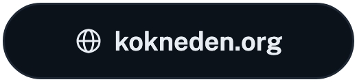
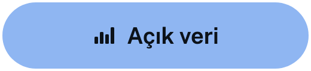
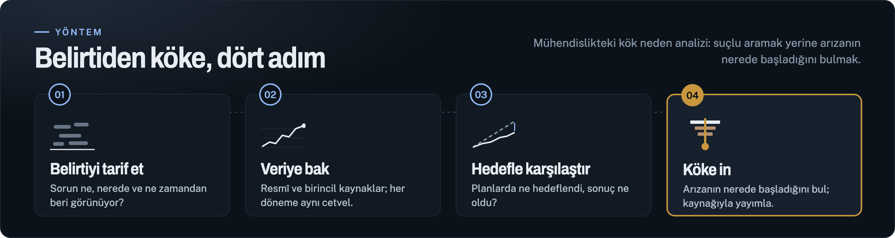
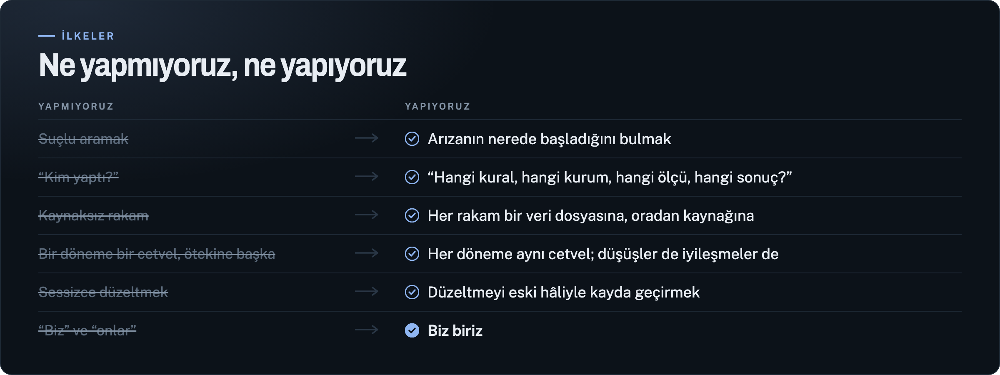
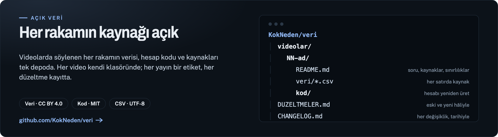
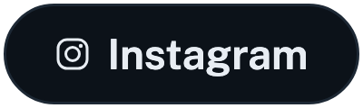

<!-- Bu dosya video/betik/github-profil.mjs ile üretilir; elle düzenleme bir sonraki üretimde kaybolur. -->

  
  
  
  

 

 

 

  

  
  
  
  
  
  

<b>Alanınızda uzman mısınız?</b> Tespitleri okuyup itiraz edecek alan uzmanlarından bir okuma ağı kuruluyor: <a href="mailto:iletisim@kokneden.org">iletisim@kokneden.org</a>

Kaynak tarama, veri işleme, metin taslakları, görseller ve seslendirme yapay zekâ araçları desteğiyle hazırlanır; her cümleyi Berk Can okuyup onaylar. Metinler <a href="https://creativecommons.org/licenses/by-nd/4.0/deed.tr">CC BY-ND 4.0</a> · veri <a href="https://creativecommons.org/licenses/by/4.0/deed.tr">CC BY 4.0</a> · kod <a href="https://opensource.org/license/mit">MIT</a>

